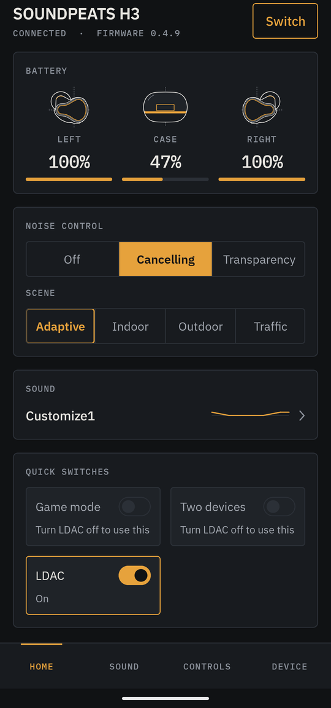
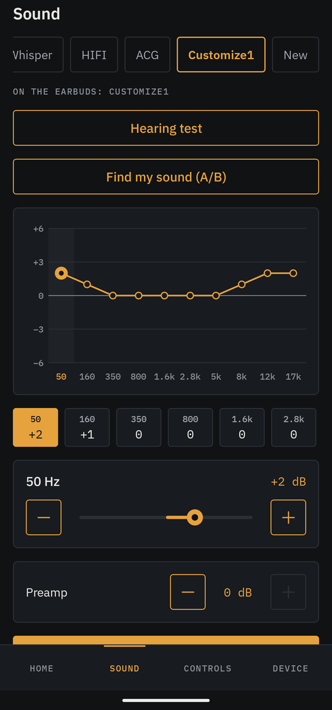
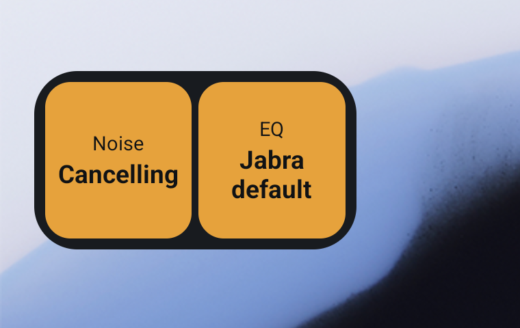
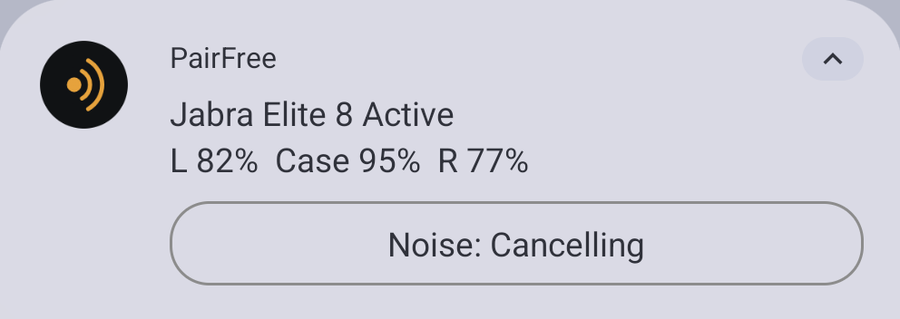
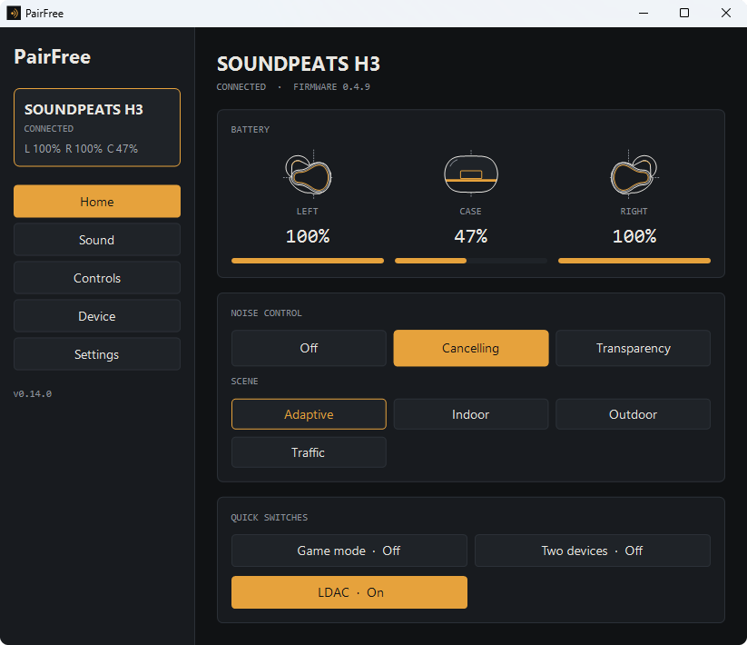
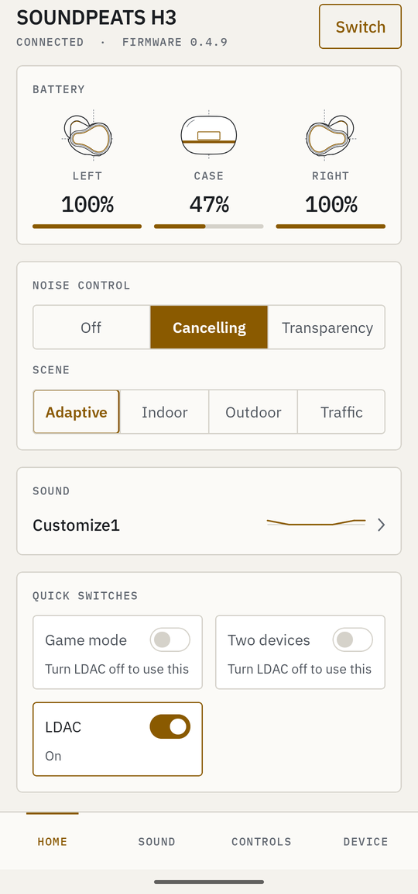
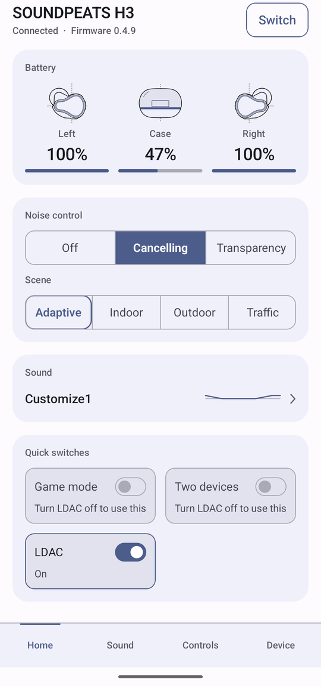
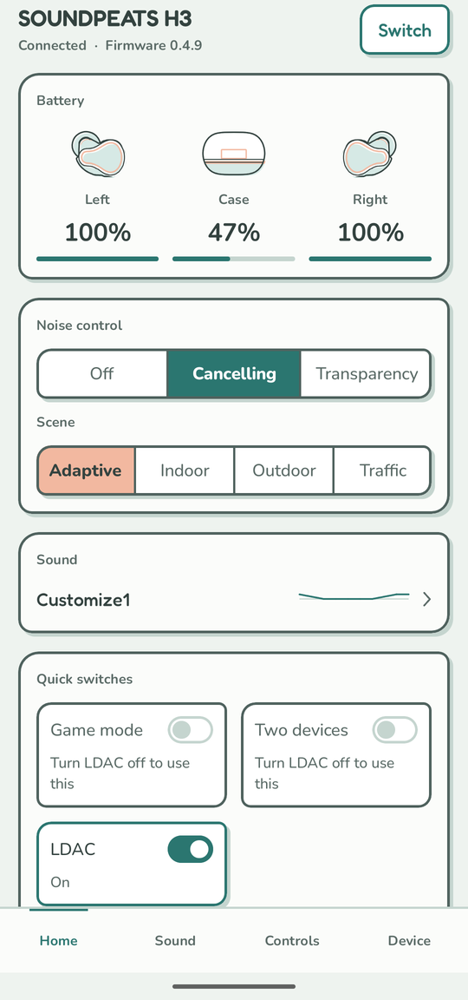

# PairFree: open-source app for earbuds and headphones, on Android and Windows

PairFree is a free, open-source app that controls wireless earbuds and headphones of many brands from one place, on **Android and on Windows**. It
is an alternative to the Soundcore, Bose Music, JBL Headphones, Sony | Sound Connect, Galaxy Wearable, Nothing X, PeatsAudio (SOUNDPEATS), QCY,
1MORE, EarFun, Melomania (Cambridge Audio), Sennheiser Smart Control, Jabra Sound+, Skullcandy and HeyMelody (OnePlus and OPPO) apps, and a way to change AirPods
and Pixel Buds settings on Android: noise cancelling, the equalizer, touch controls and more, with no account and no internet.

## Now on Windows

**Almost none of these earbuds and headphones has an app for Windows.** Their settings (noise cancelling, the equalizer, touch controls) can only be
changed from a phone, and a PC is left with plain Bluetooth audio. PairFree for Windows changes that: one small portable program, no installer, that
does what the Android app does for the same earbuds, in a window made for a mouse, with a tray icon for the battery and quick switches.
[Everything about it is on its page](docs/WINDOWS.md).

## Get it

| | |
|---|---|
| **Android** 12 or later | [F-Droid](https://f-droid.org/packages/io.github.omegadestroyer.pairfree/) or the [GitHub releases](https://github.com/Omega-Destroyer/PairFree/releases/latest) (the same signed APK) |
| **Windows** 10 or 11, 64-bit | `PairFree.exe` from the [GitHub releases](https://github.com/Omega-Destroyer/PairFree/releases/latest). Put it anywhere and run it. |

Latest release: v0.16.0. Your earbuds must be paired in the phone's or PC's Bluetooth settings first. A few brands need a newer Android:
AirPods need Android 17, or one of the few phones on Android 16 that already open their settings channel
([AirPods and Beats](docs/devices/apple.md)); they are not on Windows.

## Why PairFree

- **No account, no internet.** Nothing to sign up for. The Android app does not even have the internet permission.
- **Nothing leaves your phone or PC** unless you share it yourself, such as a device report or an equalizer profile. No ads, no analytics, no crash
  reports. (The Windows program asks once whether it may look for updates on GitHub, and does nothing else online.)
- **One app instead of a drawer full of them.** Every brand gets the same screens.
- **Light and quick.** About 6 MB on Android and 16 MB on Windows, with no login and no server to wait for.
- **Open source** (GPL-3.0), with every protocol documented and tested, and reproducible builds.
- **Your look.** Four are built in, and they follow through the screens, the device drawings and the widget (below).
- **Your equalizer, as files.** Save your own curves, and export and share them.

## What it controls

Each model shows only what it has:

- Battery for each earbud and the case.
- Noise control: off, noise cancelling, transparency or ambient sound, with their scenes and levels.
- The equalizer: the brand's presets, your own curves and saved profiles.
- Touch controls: what each tap and hold does on each earbud, and turning touch off.
- Game mode, two devices at once, LDAC and LE Audio.
- The ear tip fit test and a seal check, find my earbuds, voice prompts and water drain.
- Hearing tests that turn what you hear into an equalizer curve, and an A/B sound finder that tunes a curve by asking which of two sounds you prefer.
- Settings only one brand has, such as Sony's speak-to-chat, Bose's listening modes, JBL's TalkThru or the AirPods' Conversation Awareness.

## On Android

  
  

Home shows the battery and the quick switches; Sound is the equalizer. Controls (touch controls) and Device (the earbuds' own settings, the tests and the
report) are the other two tabs. Screenshots with a SOUNDPEATS H3, using replies recorded from real earbuds.

Outside the app, a **home screen widget** and a **status notification** switch noise control and equalizer profiles without opening it:

  
  

## On Windows

  
  

The same screens and the same earbuds' settings, laid out for a window: a sidebar for the tabs, a draggable equalizer graph, and a tray icon with the
battery and a menu for noise control and equalizer profiles. Settings live in one readable file, `PairFree.toml`, beside the program. It needs Windows 10
(version 1809) or 11 and the earbuds paired in Windows' Bluetooth settings; every brand is there except AirPods and the Beats on Apple's chips, which
Windows gives programs no way to reach. See [PairFree for Windows](docs/WINDOWS.md).

## Looks

The screens, the device drawings and the widget follow the look you choose: Studio (dark, the default), Studio Light, **Material You** (your phone's own
colours; on Windows, its accent colour) and **Sketchbook** (hand-drawn). A new look is one file added by pull request ([docs/LOOKS.md](docs/LOOKS.md)).

  
  
  

PairFree is an independent project. It is not affiliated with or endorsed by SOUNDPEATS, Anker, Samsung, Sony, Bose, Harman (JBL), Apple, Nothing (and its
CMF brand), Google, QCY, 1MORE, EarFun, Cambridge Audio, Sennheiser, Jabra, Skullcandy, OnePlus or OPPO.

## Supported brands

Each brand has a page listing every model PairFree knows and what works on each. Most models have not been tried on real earbuds yet: their support
comes from the brands' own apps, other open-source projects and the reports of people who own them, and each page says which ones have been tried.

<!-- devices-summary:start (generated by tools/device_pages.py; do not edit) -->
| Brand | Models | Tried on real earbuds |
|-------|--------|-----------------------|
| [SOUNDPEATS](docs/devices/soundpeats.md) | 88 | Air5 Pro+, C30, H3, T3 Pro, TRUEFREE Clip C10 |
| [Soundcore (Anker)](docs/devices/soundcore.md) | 83 | AeroClip, P30i, R50i NC, Q20I, Sleep A20, Space A40 |
| [Samsung Galaxy Buds](docs/devices/samsung.md) | 16 | — |
| [Sony](docs/devices/sony.md) | 24 | WF-1000XM5, WF-1000XM6 |
| [Bose](docs/devices/bose.md) | 22 | — |
| [JBL](docs/devices/jbl.md) | 112 | Live Buds 3 |
| [AirPods and Beats](docs/devices/apple.md) | 30 | AirPods Pro 3 |
| [Nothing and CMF](docs/devices/nothing.md) | 19 | Nothing Ear |
| [Google Pixel Buds](docs/devices/pixel.md) | 5 | Pixel Buds Pro |
| [QCY](docs/devices/qcy.md) | 194 | QCY H3 Pro, QCY T13 ANC2 |
| [1MORE](docs/devices/1more.md) | 48 | — |
| [EarFun](docs/devices/earfun.md) | 26 | — |
| [Cambridge Audio](docs/devices/cambridge.md) | 8 | — |
| [OnePlus and OPPO](docs/devices/oneplus.md) | 53 | OnePlus Buds 4 |
| [Sennheiser](docs/devices/sennheiser.md) | 28 | — |
| [Jabra](docs/devices/jabra.md) | 34 | Jabra Elite Active 75t |
| [Skullcandy](docs/devices/skullcandy.md) | 56 | — |
| **Total: 17 brands** | **846** | **20 tried** |
<!-- devices-summary:end -->

## Help add your model

Own earbuds or headphones that are not marked as tried? One report from you adds your model for everyone. A **device report** is a short text listing what your
earbuds say they can do and what they answered, with serial numbers and addresses hidden. It lets the project confirm your model works, correct settings that
differ, and credit you in [CONTRIBUTORS.md](CONTRIBUTORS.md).

**To send one:**

1. Connect your earbuds in PairFree and open the **Device** tab.
2. Tap **Copy device report**.
3. [Open a new issue](https://github.com/Omega-Destroyer/PairFree/issues/new) and paste it. Say what worked and what did not.

If PairFree cannot connect, the connect screen has **Copy connection report**: paste that instead.

### Record from the official app

Want to help more? If the brand's own app works with your earbuds, PairFree can record what that app sends when you change a setting, which shows exactly how
to set it. In PairFree, open the Device tab and tap **Record from the official app**; it walks you through it in about ten minutes, with no computer. It reads
the Bluetooth log only on your phone and the report it makes has no names or addresses. **Do not attach the Android bug report itself to the issue**: issues
are public, and a bug report holds far more than Bluetooth messages.

## Translating PairFree

PairFree's text is in one file, and a translation is a copy of it with the texts changed; the app then offers the language by itself. A partial translation works:
what it lacks shows in English. See [docs/TRANSLATING.md](docs/TRANSLATING.md).

## For developers

How it is built, what is in the repository, running the tests and the PC probe: [docs/DEVELOPMENT.md](docs/DEVELOPMENT.md). The design is in
[docs/DESIGN.md](docs/DESIGN.md) and each brand's protocol in `docs/<brand>/PROTOCOL.md`.

## Brand websites

<!-- site-links:start (generated by tools/gen_site.py; do not edit) -->
Each brand also has a page on the [web site](https://omega-destroyer.github.io/PairFree/):

- [Open-source SOUNDPEATS app (a PeatsAudio alternative)](https://omega-destroyer.github.io/PairFree/open-source-soundpeats-app/)
- [Open-source Soundcore app (for Anker Soundcore earbuds)](https://omega-destroyer.github.io/PairFree/open-source-soundcore-app/)
- [Open-source Bose app (a Bose Music alternative)](https://omega-destroyer.github.io/PairFree/open-source-bose-app/)
- [Open-source JBL Headphones app alternative](https://omega-destroyer.github.io/PairFree/open-source-jbl-app/)
- [Open-source Sony headphones app (a Sound Connect alternative)](https://omega-destroyer.github.io/PairFree/open-source-sony-app/)
- [Open-source Galaxy Buds app (without Galaxy Wearable)](https://omega-destroyer.github.io/PairFree/open-source-galaxy-buds-app/)
- [Open-source AirPods app for Android (noise control and settings)](https://omega-destroyer.github.io/PairFree/open-source-airpods-beats-app/)
- [Open-source Nothing X app alternative (Nothing Ear and CMF Buds)](https://omega-destroyer.github.io/PairFree/open-source-nothing-app/)
- [Open-source Pixel Buds app (for Android phones that are not Pixels)](https://omega-destroyer.github.io/PairFree/open-source-pixel-buds-app/)
- [Open-source QCY app alternative](https://omega-destroyer.github.io/PairFree/open-source-qcy-app/)
- [Open-source 1MORE app alternative](https://omega-destroyer.github.io/PairFree/open-source-1more-app/)
- [Open-source EarFun app alternative (EarFun Audio)](https://omega-destroyer.github.io/PairFree/open-source-earfun-app/)
- [Open-source Cambridge Audio Melomania app alternative](https://omega-destroyer.github.io/PairFree/open-source-cambridge-app/)
- [Open-source Sennheiser Smart Control alternative](https://omega-destroyer.github.io/PairFree/open-source-sennheiser-app/)
- [Open-source Jabra Sound+ alternative](https://omega-destroyer.github.io/PairFree/open-source-jabra-app/)
- [Open-source Skullcandy app alternative](https://omega-destroyer.github.io/PairFree/open-source-skullcandy-app/)
- [Open-source HeyMelody alternative for OnePlus and OPPO earbuds](https://omega-destroyer.github.io/PairFree/open-source-oneplus-app/)
<!-- site-links:end -->

## Credits

- [OpenSCQ30](https://github.com/Oppzippy/OpenSCQ30) by Kyle Scheuing (GPL-3.0-or-later): the
  Soundcore protocol, model list and per-model features that PairFree's Soundcore support is
  ported from. Code ported from it says so where it is.
- [FFmpeg](https://ffmpeg.org) (LGPL-2.1-or-later), whose SBC encoder (from BlueZ's SBC codec) PairFree's
  mono SBC encoder for the Soundcore Sleep A30's sounds is ported from (`SbcEncoder.kt`).
- [GalaxyBudsClient](https://github.com/timschneeb/GalaxyBudsClient) by Tim Schneeberger (GPLv3):
  the Galaxy Buds protocol, model list, per-model features and state layouts that PairFree's
  Samsung support is ported from. Code ported from it says so where it is.
- [Gadgetbridge](https://codeberg.org/Freeyourgadget/Gadgetbridge) (AGPL-3.0): its Sony support,
  used with real headphones, confirms the Sony messages PairFree reads from Sony's app, and its
  notes give the Sony model names and table sets. Facts only; none of its code is in PairFree.
- [bosectl](https://github.com/aaronsb/bosectl) by aaronsb (MIT): what works on Bose headphones
  without Bose's cloud, the payload layouts and real replies from seven Bose models, which PairFree's
  Bose support checks against Bose's own app.
- [JblTray](https://github.com/emperorbug46/JblTray) by emperorbug46 (MIT): the noise control,
  battery and feature frames it recorded from a JBL Tune Flex 2, and that its Bluetooth LE side
  answers on the classic address, which PairFree's JBL support checks against JBL's own app.
- [JBL-Headphones-App](https://github.com/FajkPes/JBL-Headphones-App) by FajkPes: the replies it
  recorded from a JBL Tune 720BT. Facts only; it has no licence, and none of its code is in PairFree.
- [LibrePods](https://github.com/kavishdevar/librepods) by LibrePods contributors (GPL-3.0-or-later):
  Apple's accessory protocol, the AirPods models and how to open their channel on Android, which
  PairFree's AirPods support is ported from. Code ported from it says so where it is.
- [MagicPodsCore](https://github.com/steam3d/MagicPodsCore) by Aleksandr Maslov and Andrei Litvintsev
  (GPL-3.0): the AirPods setting values it confirms, and the Beats and AirPods Max models. Facts only;
  none of its code is in PairFree.
- [nada](https://github.com/chukfinley/nada) by chukfinley and [nadamas](https://github.com/ezvk/nadamas)
  by ezvk, a fork of [something-x](https://github.com/SoaOaoS/something-x) by SoaOaoS (all MIT): the
  Nothing and CMF protocol as they read it from Nothing X and tried it on real earbuds, which PairFree's
  Nothing support checks against Nothing X itself.
- [pbpctrl](https://github.com/qzed/pbpctrl) by Maximilian Luz (MIT or Apache-2.0): the Pixel Buds Pro's
  Maestro service, its framing and channels, as used with a Pixel Buds Pro. PairFree's HDLC framing
  follows its code.
- [OpenControl for Pixel Buds Pro 2](https://github.com/tedsluis/opencontrolpixelbudspro2) by tedsluis
  (AGPL-3.0): what recordings of a Pixel Buds Pro 2 show, such as the EQ write and the RPC ids. Facts
  only; none of its code is in PairFree.
- [OpenQCY-Desktop](https://github.com/GiorgioRafael/OpenQCY-Desktop) by GiorgioRafael (MIT): the
  messages it recorded from a QCY MeloBuds N70, which PairFree's QCY support checks against QCY's own
  app.
- [Quicky](https://github.com/hui1601/Quicky) by hui1601: QCY's product list and the features of each
  model, and its protocol notes. Facts only; it has no licence, and none of its code is in PairFree.
- [IBM Plex](https://github.com/IBM/plex) fonts, and for the Sketchbook look [Fredoka](https://github.com/hafontia/Fredoka-One) and [Nunito](https://github.com/googlefonts/nunito) (all SIL Open Font License 1.1).

## License

GNU General Public License, version 3 or (at your option) any later version
(GPL-3.0-or-later). See `LICENSE`.

The Galaxy Buds code in `android/protocol/src/main/kotlin/io/github/omegadestroyer/pairfree/protocol/samsung/`
is ported from GalaxyBudsClient, which is licensed under version 3 of the GPL only, so those
files are GPL-3.0-only. The app built with them is shared under version 3.

The app uses one library besides AndroidX and Kotlin: [hiddenapibypass](https://github.com/LSPosed/AndroidHiddenApiBypass) by LSPosed (Apache-2.0),
which lets it open the AirPods' Bluetooth channel on phones where Android hides the needed socket (see the note under the
[AirPods and Beats table](docs/devices/apple.md)).
