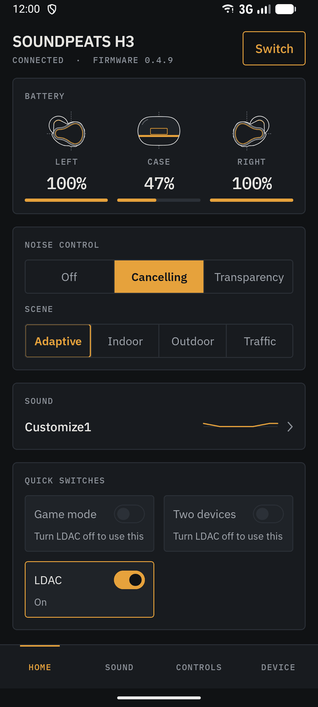
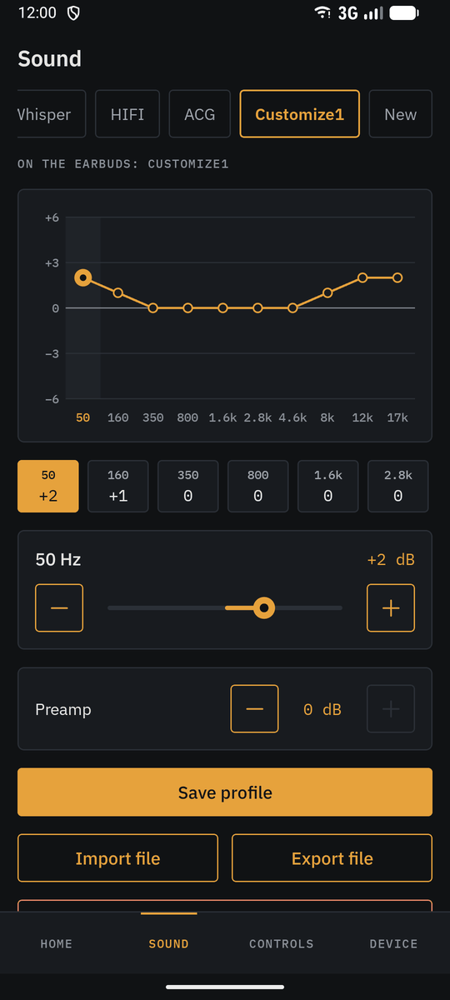
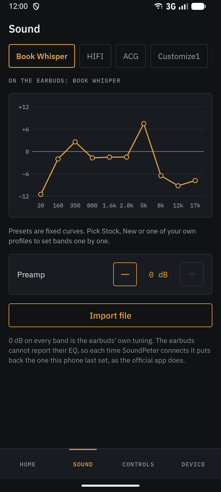
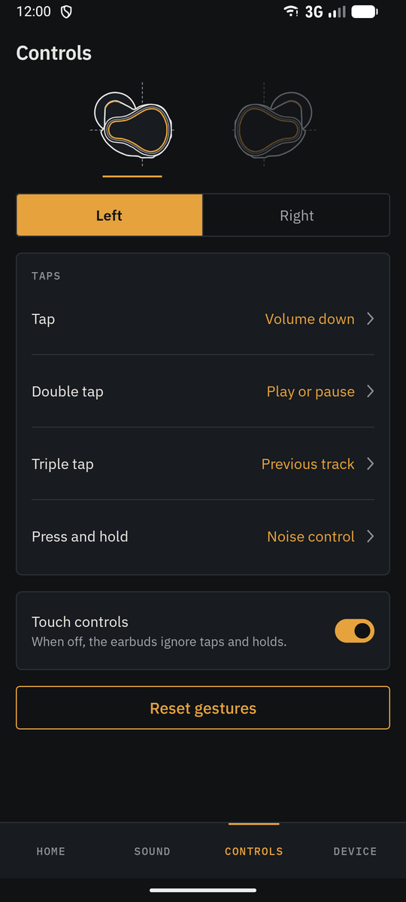
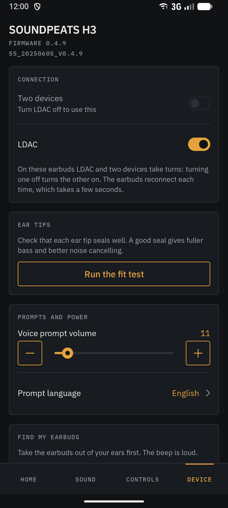
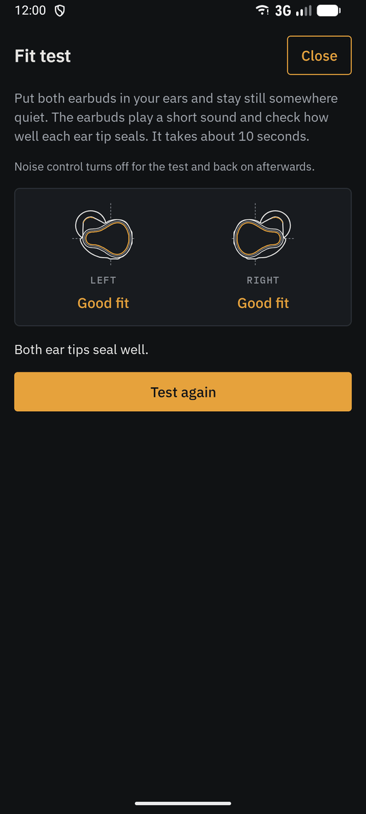

# PairFree

PairFree aims to be one app for the settings of nearly any earbuds and headphones. It
replaces heavy, brand-specific apps with a light, fast one that talks to your earbuds
directly over Bluetooth.

## Why PairFree

- **No account.** Nothing to sign up for or log in to.
- **No internet.** The app does not have the internet permission, so it cannot go online.
- **Nothing leaves your phone** unless you share it yourself, such as a device report or an
  equalizer profile. No ads, no analytics, no crash reports, no cloud backup of your
  settings.
- **One app to rule them all.** Every brand gets the same screens, so one app replaces a
  drawer full of vendor apps.
- **Few permissions.** Bluetooth, to talk to earbuds you have already paired, and
  notifications for the optional status notification. For JBL models alone, finding nearby
  devices, asked for only when you open one: most JBL models take their settings over
  Bluetooth LE, and may have to be looked for that way. PairFree tells Android it never uses
  that for your location. No location, no contacts.
- **Small and quick.** About 3 MB, with no login and no server to wait for.
- **Open source.** GPL-3.0. Every protocol is documented in this repo with tests, so anyone
  can check what the app sends to their earbuds.
- **Reproducible builds.** The published APK can be rebuilt from the source and checked byte
  for byte, apart from the signature.
- **Your equalizer, as files.** Save your own curves, and export and share them.
- **Grows with its users.** Anyone can help add a new model by sending in a device report
  (see [Help add your model](#help-add-your-model)).

## What it controls

Each model shows only what it has:

- Battery for each earbud and the case.
- Noise control: off, noise cancelling, transparency or ambient sound, with their scenes and
  levels.
- The equalizer: the brand's presets, your own curves and saved profiles.
- Touch controls: what each tap and hold does on each earbud, and turning touch off.
- Game mode, two devices at once, LDAC and LE Audio.
- The ear tip fit test, find my earbuds, voice prompts and water drain.
- Settings only one brand has, such as each Galaxy Bud's ambient sound level, voice detect,
  Sony's speak-to-chat and DSEE upscaling, Bose's listening modes, JBL's TalkThru, or the
  AirPods' Conversation Awareness.
- A status notification with the battery and buttons for noise control and game mode, in
  place of Google's Fast Pair notification if you like.

PairFree needs Android 12 or later. AirPods need Android 17, or one of the few phones on
Android 16 that already open their settings channel ([AirPods and Beats](docs/devices/apple.md)).

PairFree is an independent project. It is not affiliated with or endorsed by SOUNDPEATS,
Anker, Samsung, Sony, Bose, Harman (JBL), Apple or Nothing (and its CMF brand). It was called SoundPeter until version 0.1.3, when it was still an app for
SOUNDPEATS earbuds alone.

<p>
  
  
  
  
  
  
</p>

Screenshots with a SOUNDPEATS H3, using replies recorded from real earbuds.

## Status

Early, and growing one brand at a time. Most models have not been tried on real earbuds yet.
Their support comes from other open-source projects that worked out each brand's protocol,
and from reports their owners send in. Each brand's page shows which models have been tried.

| Piece                 | State |
|-----------------------|-------|
| Android app           | Released (v0.3.2) for SOUNDPEATS, Soundcore, Galaxy Buds, Sony, Bose, JBL, AirPods and Beats, Nothing and CMF. |
| Tried on real earbuds | SOUNDPEATS H3 and Air5 Pro+, Soundcore Space A40 |
| Protocols             | One document, data set and test suite per brand, in `docs/<brand>/` and `data/<brand>/` |
| iOS and Windows apps  | Planned, after Android |
| Firmware update       | Planned for Qualcomm-based models, opt-in |

## Supported brands

Each brand has a page listing every model PairFree knows and what works on each.

<!-- devices-summary:start (generated by tools/device_pages.py; do not edit) -->
| Brand | Models | Tried on real earbuds |
|-------|--------|-----------------------|
| [SOUNDPEATS](docs/devices/soundpeats.md) | 45 | Air5 Pro+, H3 |
| [Soundcore (Anker)](docs/devices/soundcore.md) | 66 | AeroClip, Sleep A20, Space A40 |
| [Samsung Galaxy Buds](docs/devices/samsung.md) | 16 | — |
| [Sony](docs/devices/sony.md) | 24 | — |
| [Bose](docs/devices/bose.md) | 22 | — |
| [JBL](docs/devices/jbl.md) | 99 | — |
| [AirPods and Beats](docs/devices/apple.md) | 30 | — |
| [Nothing and CMF](docs/devices/nothing.md) | 19 | — |
<!-- devices-summary:end -->

**LDAC on Samsung phones:** turning LDAC on in PairFree makes the earbuds offer it, but the phone picks
the codec. Samsung phones can also need LDAC turned on for the earbuds in their own Bluetooth settings
(tap the gear next to the earbuds); other phones may have a similar switch. PairFree reminds you when you turn
LDAC on: [details](docs/devices/soundpeats.md#ldac-on-samsung-phones).

## What is in the repo

Each brand has its own folders, named after the brand: `docs/<brand>/`, `data/<brand>/`,
`assets/devices/<brand>/` and `tools/device_art/<brand>/`.

| Path                      | What it is                                                        |
|---------------------------|-------------------------------------------------------------------|
| `docs/DESIGN.md`          | The app design: requirements, the Studio look, screens            |
| `docs/devices/`           | One page per brand: every model PairFree knows and what works on each |
| `docs/<brand>/PROTOCOL.md` | The brand's protocol: transport, frames, commands, EQ and more  |
| `data/<brand>/commands.json` | The brand's command table in machine-readable form. Apps load or mirror this. |
| `data/<brand>/devices.json` | Known models and their per-model details                        |
| `data/<brand>/test_vectors.json` | Frames every implementation must reproduce byte for byte   |
| `data/<brand>/reports/`   | Device reports and recordings from real earbuds, one file per model and firmware |
| `data/soundpeats/qcy_commands.json` | The separate protocol for the SOUNDPEATS Capsule3 Pro   |
| `data/soundcore/eq_presets.json`, `button_actions.json` | Soundcore EQ presets and touch actions, from OpenSCQ30 |
| `data/samsung/messages.json` | The Galaxy Buds message table, from GalaxyBudsClient          |
| `data/sony/functions.json`, `eq_presets.json` | What Sony earbuds list they have, and Sony's EQ presets, from Sony's app |
| `data/bose/commands.json` | Bose's BMAP function table, from Bose's app                      |
| `data/jbl/commands.json`  | The Harman commands PairFree uses with JBL models, from JBL's app |
| `data/apple/commands.json` | Apple's accessory protocol as PairFree uses it with AirPods, from LibrePods |
| `data/nothing/commands.json` | Nothing's command table, from Nothing X                      |
| `tools/probe.py`          | Read-only probe for SOUNDPEATS earbuds. Asks them what they support. |
| `tools/import_eq_capture.py` | Turns the equalizer part of a recording from PeatsAudio into a model's EQ data. |
| `tools/import_openscq30.py` | Refreshes the Soundcore model list from a local copy of OpenSCQ30. |
| `tools/import_galaxybudsclient.py` | Refreshes the Galaxy Buds model list from a local copy of GalaxyBudsClient. |
| `tools/device_pages.py`   | Writes the tables on the device pages and the summary above, with `gen_models_table.py` (SOUNDPEATS), `gen_soundcore_table.py` (Soundcore), `gen_samsung_table.py` (Samsung), `gen_sony_table.py` (Sony), `gen_bose_table.py` (Bose), `gen_jbl_table.py` (JBL), `gen_apple_table.py` (AirPods and Beats) and `gen_nothing_table.py` (Nothing and CMF). |
| `tools/fetch_server_data.py` | Owner-only research tool for SoundPEATS' server. The server now refuses it (authentication), so it gets nothing. |
| `tools/test_*.py`         | Tests for the tools and the data files. No hardware needed.       |
| `assets/devices/<brand>/` | Vector drawings of each model's earbud and case, per look         |
| `tools/gen_device_art.py` | Generates those drawings. Edit the shapes there, not the SVG files. |
| `tools/device_art/<brand>/` | Traced outlines for each model, read by `gen_device_art.py`     |
| `android/`                | The Android app. `protocol/` is the protocol core, `app/` the app. |

## Help add your model

One report from someone who owns a model adds it to its brand's page
([Supported brands](#supported-brands)) for everyone. There are three ways to make one. The
first, a recording of the brand's own app, gives the most.

### Record from the official app

This gathers everything in one go, from the brand's own app: PeatsAudio (or SOUNDPEATS) for
SOUNDPEATS earbuds, Soundcore for Soundcore earbuds, Galaxy Wearable for Galaxy Buds, Sound
Connect for Sony earbuds and headphones, Nothing X for Nothing and CMF (not yet Bose, JBL, AirPods or Beats: see their pages). It records what that app
reads from your earbuds and what it sends when you change a setting, which shows exactly how PairFree should set it, and adds PairFree's own device report. On
SOUNDPEATS earbuds it also gets the equalizer curves and presets. It takes about ten minutes
on your phone, with no computer.

In PairFree, open the Device tab and tap **Record from the official app** (or the button on
the Sound tab). It walks you through it:

1. Turn on Developer options and set **Bluetooth HCI snoop log** to **Enabled**.
2. In the official app, open each screen once. Then change each setting you want PairFree to
   learn, one at a time and a few seconds apart, and note what you changed. On SOUNDPEATS
   earbuds, also run PeatsAudio's fit test if it has one, and tap SOUNDPEATS Classic and
   every other EQ preset once.
3. Take a bug report from Developer options (**Take bug report**, then **Full report**).
   **It takes several minutes, and Android shows nothing while it works: wait for the
   notification that says it is ready.** Then tap it and share it to PairFree.
4. On SOUNDPEATS earbuds, name each EQ curve PairFree found. Tap **Send on GitHub**, and
   write in the report what you changed in the official app, in order.

PairFree reads the bug report only on your phone and keeps nothing but the messages
exchanged with your earbuds. The report you send has no names or addresses: it shows only
the messages PairFree knows, with the earbuds' address and serial number masked, and of the
others little more than their number and size. Afterwards, turn the snoop log off and
delete the bug report. **Do not attach the bug report itself to the issue:** issues are public,
and a bug report holds far more than Bluetooth messages (your accounts, apps, places and the like).
If the project needs more than PairFree's report, it will ask in the issue.

### Copy device report

Quicker, and no official app needed, but it holds only what the earbuds report: no
equalizer curves, and nothing of how the official app changes a setting. Connect the earbuds in PairFree,
tap **Copy device report** on the Device tab, and paste it into a new issue. It lists every
setting PairFree can read and what the earbuds answered. On Soundcore earbuds it holds the
earbuds' whole state reply, with the serial number masked, which checks the model's row in
the [Soundcore table](docs/devices/soundcore.md#all-models). On Galaxy Buds it holds their
whole state, as bytes and as PairFree read it, for the
[Samsung table](docs/devices/samsung.md#all-models). On Sony earbuds and headphones it lists the
functions they report and the last message of each kind they sent, for the
[Sony table](docs/devices/sony.md#all-models). On Bose headphones and earbuds it lists the
product, the firmware and each read's last answer, for the [Bose table](docs/devices/bose.md#all-models),
and on JBL's the same for the [JBL table](docs/devices/jbl.md#all-models). On AirPods and Beats it lists
the model number, firmware, battery and the settings they reported, for the
[AirPods and Beats table](docs/devices/apple.md#all-models). On Nothing and CMF earbuds and headphones it
lists the product, the firmware and each read's last answer, for the
[Nothing and CMF table](docs/devices/nothing.md#all-models).

### Probe from a PC

The same information as Copy device report, for SOUNDPEATS earbuds, from a PC with Bluetooth
and Python 3.9 or newer.

1. Pair the earbuds with the PC.
2. Close PeatsAudio on your phone. Only one client can hold the connection.
3. Run:

   ```
   python tools/probe.py --mac AA:BB:CC:DD:EE:FF
   ```

   On Windows, if the earbuds show up as a COM port:

   ```
   pip install pyserial
   python tools/probe.py --port COM5
   ```

4. Open a device report issue and paste the output.

The probe only sends read commands. It does not change any setting.

## Running the tests

```
python -m unittest discover -s tools -v
```

The Android protocol module runs the same test vectors. It needs JDK 17 or newer and
the Android SDK; Android Studio brings both.

```
cd android
./gradlew :protocol:test
```

## Ground rules

- No decompiled code, vendor SDKs, firmware images or server keys in this repo.
  Everything here is written from the protocol description.
- Commands that reset, reboot or flash the earbuds are never sent without an
  explicit confirmation from the person holding them.

## Credits

- [OpenSCQ30](https://github.com/Oppzippy/OpenSCQ30) by Kyle Scheuing (GPL-3.0-or-later): the
  Soundcore protocol, model list and per-model features that PairFree's Soundcore support is
  ported from. Code ported from it says so where it is.
- [GalaxyBudsClient](https://github.com/timschneeb/GalaxyBudsClient) by Tim Schneeberger (GPLv3):
  the Galaxy Buds protocol, model list, per-model features and state layouts that PairFree's
  Samsung support is ported from. Code ported from it says so where it is.
- [Gadgetbridge](https://codeberg.org/Freeyourgadget/Gadgetbridge) (AGPL-3.0): its Sony support,
  used with real headphones, confirms the Sony messages PairFree reads from Sony's app, and its
  notes give the Sony model names and table sets. Facts only; none of its code is in PairFree.
- [bosectl](https://github.com/aaronsb/bosectl) by aaronsb (MIT): what works on Bose headphones
  without Bose's cloud, the payload layouts and real replies from seven Bose models, which PairFree's
  Bose support checks against Bose's own app.
- [JblTray](https://github.com/emperorbug46/JblTray) by emperorbug46 (MIT): the noise control,
  battery and feature frames it recorded from a JBL Tune Flex 2, and that its Bluetooth LE side
  answers on the classic address, which PairFree's JBL support checks against JBL's own app.
- [JBL-Headphones-App](https://github.com/FajkPes/JBL-Headphones-App) by FajkPes: the replies it
  recorded from a JBL Tune 720BT. Facts only; it has no licence, and none of its code is in PairFree.
- [LibrePods](https://github.com/kavishdevar/librepods) by LibrePods contributors (GPL-3.0-or-later):
  Apple's accessory protocol, the AirPods models and how to open their channel on Android, which
  PairFree's AirPods support is ported from. Code ported from it says so where it is.
- [MagicPodsCore](https://github.com/steam3d/MagicPodsCore) by Aleksandr Maslov and Andrei Litvintsev
  (GPL-3.0): the AirPods setting values it confirms, and the Beats and AirPods Max models. Facts only;
  none of its code is in PairFree.
- [nada](https://github.com/chukfinley/nada) by chukfinley and [nadamas](https://github.com/ezvk/nadamas)
  by ezvk, a fork of [something-x](https://github.com/SoaOaoS/something-x) by SoaOaoS (all MIT): the
  Nothing and CMF protocol as they read it from Nothing X and tried it on real earbuds, which PairFree's
  Nothing support checks against Nothing X itself.
- [IBM Plex](https://github.com/IBM/plex) fonts (SIL Open Font License 1.1).

## License

GNU General Public License, version 3 or (at your option) any later version
(GPL-3.0-or-later). See `LICENSE`.

The Galaxy Buds code in `android/protocol/src/main/kotlin/io/github/omegadestroyer/pairfree/protocol/samsung/`
is ported from GalaxyBudsClient, which is licensed under version 3 of the GPL only, so those
files are GPL-3.0-only. The app built with them is shared under version 3.
