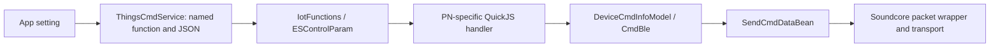

# Soundcore 5.0.35-435: Things / OMC protocol path

This is a third protocol/inventory path alongside the compiled app and SDK registries. It is required before claiming coverage of every device supported by the installed vendor app.

## Model discovery

`BaseSeriesHelp.m()` reads online product definitions through `ThingsModelUtil.f()`, creates `ThingsProductModel` instances, copies their SPP UUIDs and merges them into the normal model map. `ThingsModelUtil.d()` supplies a separate OMC product list. The list implementations are storage-backed; existing preferences and accounts were not read in this research.

`ProductListViewModel` combines online series/product-code data with Things product descriptions. The resulting model metadata includes product code, name, identifier, SPP/service UUIDs, UUID prefix/suffix and a Soundcore device-type flag. UUID defaults in that conversion are fallback values, not evidence that all online products share those identifiers.

The 165 compiled-registry keys are therefore a measured inventory of the APK's explicit registrations, not a ceiling on online support. The full online catalogue and per-product definitions have not yet been recovered. Resource names, cached list types and generic Things support cannot supply that missing count.

## Packet construction path

`IotFunctions.jsonToControlResultModel` combines caller JSON with a device value, creates an `ESControlParam` containing the product identifier and named function, calls `ESIotDeviceControlManager.controlDevice`, then decodes the returned data JSON into `DeviceCmdInfoModel`. The inverse route uses `hexToStatusResultModel` for received status.

`ESIotDeviceControlManager` maintains a controller per product number. `ESIotDeviceAndroidHandlerQuickJs` runs the product's JavaScript and uses the `controlDevice` and `deviceStatus` entry points. It obtains script content through `TDRepository.getJSFileContent`, with a `downloadJSFileByPN` path when needed. `TDRepositoryImpl` also exposes local/cloud Thing Description retrieval. This explains why recovering generic Java classes alone cannot establish the exact function bytes for all online products: the per-product script and description are inputs to the encoding and decoding.

`CmdBle.getRealCmdHeader` concatenates `cmdHead` and `cmd`, converting integer values to bytes. `getRealCmdBody` converts the body list to bytes. `ThingsCmdService.E6` places the returned prefix into the command-without-additional-payload route; `F6` supplies prefix and array payload separately. Neither helper by itself establishes a complete transmitted frame. Resolve the selected transport/wrapper and returned command metadata as well.

## Named functions used by the app

The following are identifiers and JSON field names from the recovered app bridge. They are not inferred wire opcodes. Fallback names refer to the superclass implementation when no schema result is available.

| Bridge method | Function identifier | JSON fields | Legacy fallback method |
| --- | --- | --- | --- |
| G1 | SET_TOUCH_LOCK | switch | X3 |
| H0 | GET_AUDIO_PLAY_TYPE | No JSON property supplied | H0 |
| M0 | SET_ANC_STATE | sc_anc_mode, sc_anc_option_manual, sc_anc_option_auto, sc_trancparency_sub_mode, sc_anc_auto_mode, sc_is_wind_noise_suppression | M0 |
| S3 | CONNECT_TO_SPECIFIED_DEVICE | mac | S3 |
| X3 | SET_LOW_POWER_TONE | switch | X3 |
| Z1 | SET_KEY_TONE | switch | Z1 |
| Z3 | REMOVE_FROM_HISTORICAL_DATA | mac | Z3 |
| a4 | TEST_HEADSET_FIT | No JSON property supplied | a4 |
| j0 | RE_SET_CUSTOM_UI | No JSON property supplied | j0 |
| m1 | DISCONNECT_THE_SPECIFIED_DEVICE | mac | m1 |
| p4 | SET_CUSTOM_UI | earphone_type, un_tws_fun, tws_fun, btn_type | p4 |
| r0 | OPEN_FIND_DEVICE | switch_left, switch_right, switch_case | r0 |
| r3 | SET_ONE_TO_TWO_FUNCTION | switch | r3 |
| s1 | CONNECT_NEW_DEVICES | No JSON property supplied | s1 |

The ANC bridge supplies mode, manual/automatic levels, transparency submode, automation mode and wind-noise suppression separately. The custom-UI bridge supplies side, gesture, TWS function and non-TWS function as named properties; their serialization is delegated to the product script. These field names must not be converted to fixed byte positions without that script's evidence.

## Recovery and verification status

An additional **351 Things/schema/repository classes with 2,353 methods** were selected and recovered through the offline instrumentation harness. Their live DEX index has zero instruction-store markers remaining. This is in addition to the earlier 2,984-class protocol selection. All raw/vendor artifacts remain outside Git. `TDRepositoryImpl.downloadJSFileByPN` still has a Java decompiler failure despite restored instructions; examine its bytecode or a different decompiler before drawing conclusions about that branch.

The bundled `assets/resource.zip` was inspected by archive member names only: its 319 entries describe ambient sound resources, not an identified per-product protocol script bundle. No inference is made about other encrypted or downloaded resources from that check.

No Things command was sent or invoked through the encoding engine, and no vendor API request or account login was made. Virtual checks currently cover the static wrapper/D1206 cases recorded in [recovery evidence](APK_RECOVERY_5_0_35.md).

## Remaining requirements for full coverage

1. Recover the active online product catalogue, including region/version selection and entries absent from compiled registries.
2. Trace the repository/script manager to the per-product descriptions and JavaScript resources. Preserve product code, version and content hashes. Inspect bundled resources or use only permitted unauthenticated vendor resources; do not reuse account credentials or expose signing material.
3. Trace each named function to its wire command, ordered payload and status fields. Record unsupported functions explicitly and preserve any legacy fallback behavior.
4. Exercise those scripts/serializers offline with synthetic state, including firmware boundaries, before marking their commands virtually checked.

Local continuation artifacts: `things-protocol-index.json`, `things-recovery-summary.json`, `live-fixed/`, `live-jadx/sources/com/anker/esiotkit/` and the focused `td-jadx/` tree under the external research root listed in the recovery document.

## Script discovery follow-up

A further 95 selected script-discovery/request-routing classes (601 methods) were recovered with zero remaining instruction-store markers in those classes. The new source tree is `discovery-jadx/`, with measurements in `script-discovery-summary.json` and `script-discovery-class-index.json` outside Git.

`JSFileManagerImpl` computes a document directory per configured environment and a `JavaScript` child directory. The observed naming variants are `<PN>.js`, `<PN>.zip`, `<PN>New.js`, `<PN>New.zip` and `<PN>Handle.mix.js`. The `New` suffix is controlled by its `isNew` argument. These are source-derived paths, not files read from an existing user's installation. Its read path can call back into the repository to obtain a missing product resource.

All ten APK members were checked by archive entry names for product-script/archive patterns. The only three `.js` entries were Flutter toast/wakelock helpers and `WebViewJavascriptBridge.js`; none was a PN-specific Things handler. One broad PN/archive name match was `assets/lottie/a3953_run_data.zip`, an animation-path candidate, not an identified protocol bundle. This is a filename inventory, not proof that no differently named or encrypted bundle exists. Secret assets were not opened.

### Catalogue request path

`ThingNetApi` exposes these relative POST paths relevant to catalogue/configuration discovery:

| Relative path | Result role |
| --- | --- |
| `app/things/get_product_list` | Product descriptions; includes a Category header argument |
| `app/things/get_product_category_list` | Product categories |
| `app/things/get_product_config` | Product/Thing configuration; two typed overloads |
| `app/things/get_things_list` | Thing Description model results |

Other methods query pairing information or resolve a PN from an SN. The SN lookup is not a permitted shortcut for this catalogue research because it requires a device identifier. None of these methods was called.

Request construction is more involved than an optional account login: `GlobalHeaderRouting` adds account-token headers only when its provider returns a token; `CryptoRouting` defaults its encryption requirement to true, with an explicit internal opt-out; and Soundcore registers a timestamp-signing callback through `SoundCoreThingIot.j`/`k`. The callback delegates to its secret-dependent signing routine. That callback was not invoked and no secret value or credential was read or used.

These code paths do **not** establish whether the catalogue server accepts an unsigned anonymous request. No server response or authentication refusal has been observed. Endpoint-specific exceptions, exact configuration and a permitted unsigned/public resource path remain to be traced before any research fetch. Do not label the online catalogue impossible or login-only on this evidence, and do not replay app credentials to obtain it.
